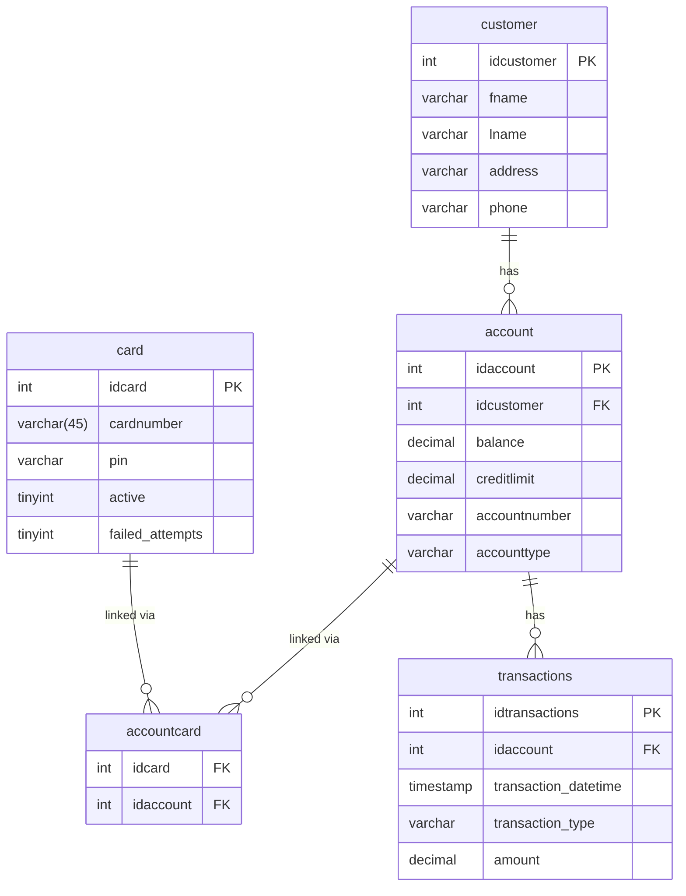
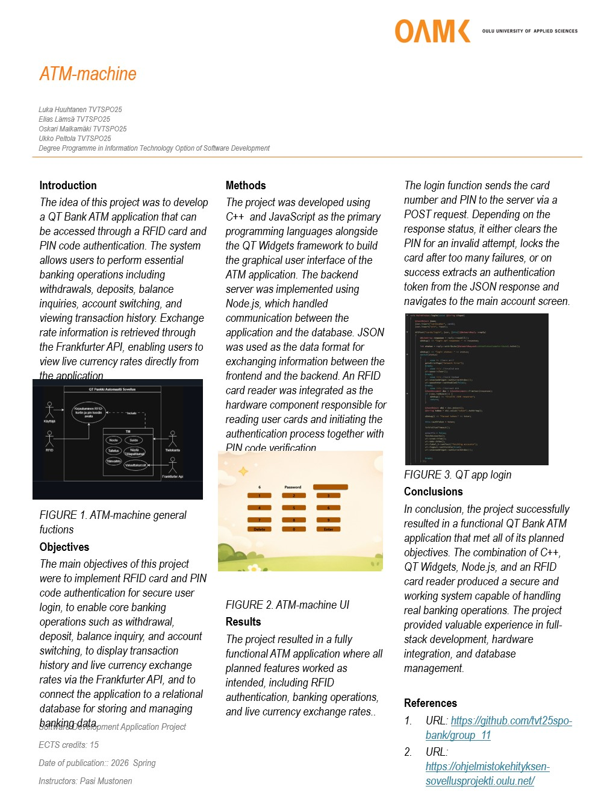

# Group 11 - ATM Simulator

A bank ATM simulator built as a school project at Oulu University of Applied Sciences (OAMK).

## Tech stack

- **Frontend:** Qt Framework (C++, qmake)
- **Backend:** Node.js / Express.js REST API (MVC architecture)
- **Database:** MariaDB
- **Authentication:** JWT + bcrypt
- **Deployment:** Oracle Cloud (Ubuntu), PM2

## Features

- Card login with PIN verification and bcrypt hashing
- Card locking after 3 failed PIN attempts (persisted to database)
- JWT-based session authentication
- Duak card support (debit + credit on the same card)
- Balance inquiry for debit and credit accounts
- Cash withdrawal with preset and custom amounts
- Deposit
- Account-to-account transfer by account number
- Paginated transaction history (10 per page, forward/back navigation)
- 10 second PIN entry timeout
- 30 second inactivity timeout
- Live currency exchange rates with daily change (Frankfurter API)
- Full CRUD operations for all database tables
- Input validation, rate limiting and security headers

## System architecture

```
Qt Desktop Client (C++)
        |
        | HTTP/JSON + JWT
        v
Node.js / Express.js REST API
        |
        | SQL
        v
MariaDB Database
```

## Project structure

```
group_11/
├── bank-automat/       # Qt C++ frontend
├── bankatm/            # Node.js backend
|   ├── controllers/    # Request handling logic
|   ├── models/         # Database queries (SQL)
|   ├── routes/         # API route configuration
|   ├── middleware/     # JWT authentication
|   └── app.js          # Express app entry point
└── documents/          # Project documentation
```

## API Endpoints

All endpoints except `/api/cards/login` require `Authorization: Bearer <token>`

| Method | Endpoint | Description |
|---|---|---|
| POST | /api/cards/login | Login with card number and PIN |
| POST | /api/cards/logout | Logout |
| GET | /api/customers/ | Get logged-in customer details
| GET | /api/accounts/:idaccount | Get account details |
| GET | /api/transactions/:idaccount | Get paginated transaction history
| POST | /api/transactions/withdraw | Withdraw from account |
| POST | /api/transactions/deposit | Deposit to account
| POST | /api/transactions/transfer | Transfer between accounts by account number |
| GET | /api/currency | Get current EUR exchange rates |
| GET | /api/currency/change | Get rate exchange vs previous business day |
| GET | /api/cards | Get all cards (CRUD) |
| POST | /api/cards/ | Create card (CRUD) |
| PUT | /api/cards/:idcard | Update card (CRUD) |
| DELETE | /api/cards/:idcard | Delete card (CRUD) |
| GET | /api/accounts/ | Get all accounts (CRUD) |
| POST | /api/accounts/ | Create account (CRUD) |
| PUT | /api/accounts/:idaccount | Update account (CRUD) |
| DELETE | /api/accounts/:idaccount | Delete account (CRUD) |
| POST | /api/customers/ | Create customer (CRUD) |
| PUT | /api/customers/:idcustomer | Update customer (CRUD) |
| DELETE | /api/customers/:idcustomer | Delete customer (CRUD) |

## Database schema



## Setup

### Prerequisites
- Node.js
- MariaDB
- Qt Creator with qmake / VSCode with Qt extensions

### Backend

```bash
cd bankatm
npm install
```

create a `.env` file:

```
DB_HOST=localhost
DB_USER=your_db_user
DB_PASSWORD=your_db_password
DB_NAME=bankatm
DB_PORT=3306
JWT_SECRET=your_jwt_secret
PORT=3000
```

Import the database schema:

```bash
mysql -u root -p bankatm < dbdump.sql
```

Start the server:

```bash
npm start
```

### Frontend

1. Open `bank-automat/` in Qt Creator or VSCode
2. Build with qmake
3. Run the application

## Team & Responsibilities

| Member | Role |
|---|---|
| L.H | Backend (Node.js, REST API, database, server) |
| E.L | Backend (Node.js, REST API, database) |
| O.M | Qt frontend |
| U.P | Qt frontend |

## Poster



## License

MIT License
